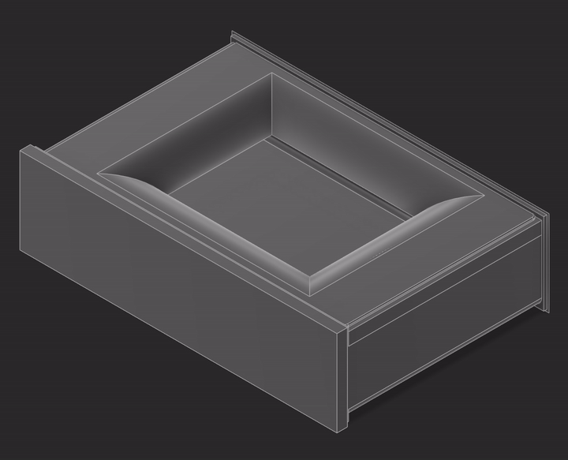
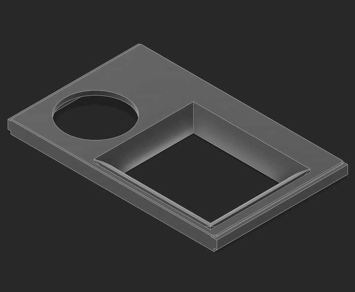
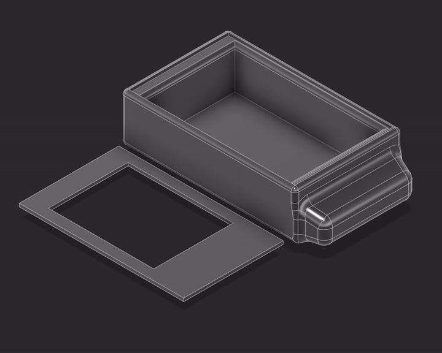

# Enclosure Design

The receiver is housed in a 3D-printed case styled after a vintage television set, with a simplified faceplate as a practical alternative during testing.

***

## Television-Inspired Frame

The main enclosure. The display sits recessed in the bezel where a picture tube would be, and the keypad and rotary encoder become front-panel controls, so the finished receiver reads as a small television rather than a circuit board in a box.

  

[**View model**](https://purdue7345.autodesk360.com/shares/public/SH90d2dQT28d5b602811f570cf8a0327ade4)

***

## Makeshift Cover

A single faceplate carrying a rectangular window for the screen and a circular opening beside it, rather than a full shell. It prints in a fraction of the time, uses far less material, and lifts straight off for access to the boards underneath during testing.

  

[**View model**](https://purdue7345.autodesk360.com/shares/public/SH90d2dQT28d5b6028119c5c54ecb730d2ee)

***

## First Iteration

The original attempt: a deep tray with a separate drop-in faceplate. The two-part construction made assembly awkward and the tray was deeper than the boards actually needed, so the design was replaced. It is kept here as a record of how the enclosure developed.

  

[**View model**](https://purdue7345.autodesk360.com/shares/public/SH90d2dQT28d5b60281185a0c66bb7559dfb)

***

PCB layouts live in [SSTV-Hardware](https://github.com/PurdueECE-362-SSTV-Project/SSTV-Hardware).
